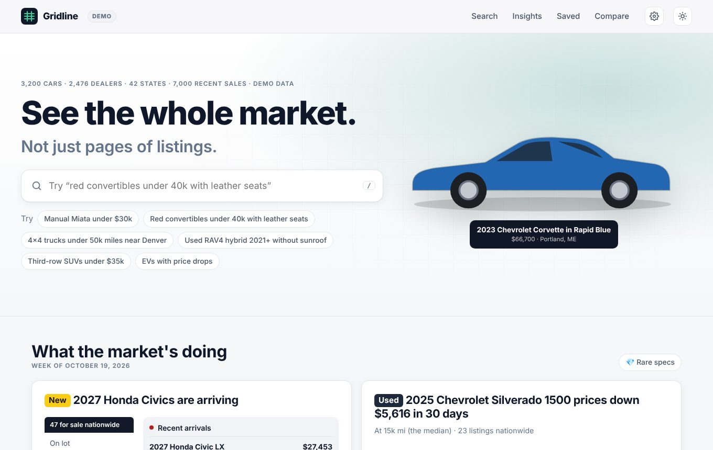
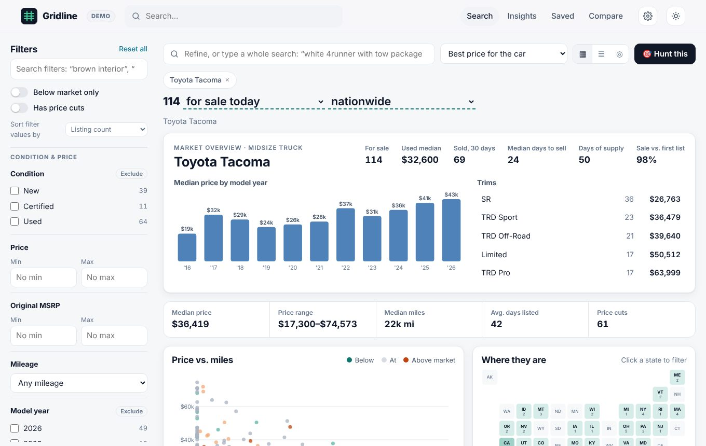
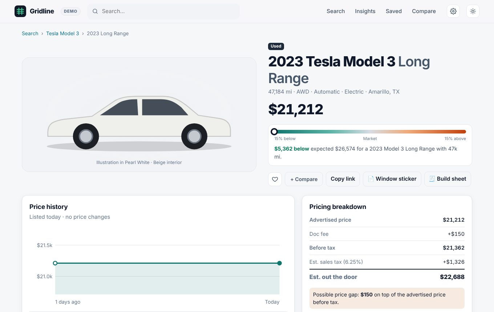

<p align="center"></p>

<h1 align="center">Gridline</h1>

<p align="center"><b>See the whole car market, not just pages of listings.</b><br>
Search every car for sale, see what each one should cost and why, and get told the moment the car you're hunting for shows up or drops its price.</p>

<p align="center"><b><a href="https://bollineni-create.github.io/hotwheels/">Open Gridline in your browser</a></b> · <a href="#the-mac-app">Get the Mac app</a></p>



## What it does

- **Search the way you talk.** "Manual Miata under $30k", "4x4 trucks under 50k miles near Denver" or "white Lexus GX with brown interior". Every filter shows how many cars you'd get by picking it, and every search is a link you can share or bookmark.
- **A fair price for every car.** Gridline learns what each model is worth for its age, mileage, transmission and paint, then shows every car's dollar gap to that price, with the working shown. No unexplained "great deal" badges.
- **The whole market at a glance.** Each search plots price against miles and maps where the cars are. Pick one model to see prices by year, the trim mix, how fast they sell and how many have had price cuts.
- **Hunts.** Press **🎯 Hunt this** on any search and Gridline keeps watching it. You get a notification when a new match is listed or one drops its price, and a page showing what changed since you last looked and how rare the car really is.
- **Everything about one car.** Its full price history, how it compares with similar cars, a pricing breakdown to the out-the-door total, a payment calculator, a VIN decode, the window sticker and build sheet, earlier listings of the same VIN, and NHTSA recalls and complaints.
- **What the market's doing.** Weekly cards worked out from the data itself: new models arriving, the biggest price moves, which cars hold their value, this week's price cuts and where cars cost less.
- **Deal Check and Compare.** Put in a dealer's numbers (add-ons, fees, trade-in, APR) and see the real total against the market, or line up four cars side by side with the best of each row highlighted.
- **Free real listings.** Connect a free [auto.dev](https://auto.dev/pricing) key for cars for sale from US dealers right now, or a [Visor](https://visor.vin/account/api) key for sold cars and history too. Without a key it runs on a realistic demo market.
- **Private.** Hunts, favorites, keys and recently viewed stay on your device and are never sent anywhere.





## The Mac app

Paste this into Terminal. It downloads Gridline to `~/hotwheels`, builds the app, puts it in **Applications** and opens it. If your Mac doesn't have Apple's command-line tools yet, it offers to install them first.

```bash
curl -fsSL https://raw.githubusercontent.com/bollineni-create/hotwheels/main/app/macos/install.sh | zsh
```

The first time, it asks for your Visor and auto.dev keys so you get real listings (Visor is used when both are given). Press Enter to skip either; with neither, it uses the demo listings. To build the keys in without being asked, put them in front of `zsh`: `... | VISOR_KEY=your_visor_key AUTODEV_KEY=your_autodev_key zsh`. Keys are saved in `electron/keys.local.json`, which git ignores, so they never get uploaded.

After that, open Gridline from Applications, Launchpad, Spotlight or the Dock like any other app.

**It updates itself.** Each time you open or switch to it, and every 15 minutes while it's open, it pulls the latest `main` from GitHub into `~/hotwheels`, and page changes show up in the open window within a second. If an update changed the Mac app itself (`app/macos/`), Gridline rebuilds, reinstalls and reopens itself. Edits you make in `~/hotwheels` show up right away too, which makes it a handy live preview while you work on the site. If the folder moves, it falls back to the copy built into the app. Running the install line again also updates and reinstalls.

The red close button hides the window rather than quitting, so hunts keep watching; click the Dock icon to bring it back, or quit with `⌘Q`. The build is ad-hoc signed, so on another Mac you'll need to right-click it and choose **Open** the first time.

To rebuild by hand from a clone: `./app/macos/build.sh` (or `--no-install` to build into `build/` only).

### Keyboard

| Key | Does |
| --- | --- |
| `/` | Search (or the filter search, on the search page) |
| `⌘F` or `⌘K` | Search (desktop apps) |
| `⌘N` | New search |
| `⌘1` to `⌘5` | Home, Search, Insights, Saved & Hunts, Compare |
| `⌘[` `⌘]` | Back and forward |
| `⌘,` | Settings (Mac app) |
| `↑` `↓` `Enter` | Move through and pick search suggestions |
| `⌘Enter` | In the filter search: add the filter and keep searching |

On Windows and Linux, use `Ctrl` in place of `⌘`.

## Run it

It's a static site with no build step: HTML, CSS and plain JavaScript. It needs [Node.js](https://nodejs.org) 18 or newer only for the local server, the tests and the Electron app.

```bash
git clone https://github.com/bollineni-create/hotwheels.git
cd hotwheels
npm start          # http://localhost:8080; the local server also relays live-data requests
npm test           # node's built-in test runner
```

**On the web.** The public site at https://bollineni-create.github.io/hotwheels/ is served by GitHub Pages from the root of `main`, so it updates on its own within a minute or two of every merge. Before committing changes to the JS or CSS, run `./tools/stamp-version.sh`: it stamps a fresh `?v=` on the page's script and stylesheet links, so visitors get the new files instead of a cached mix of old and new.

**As an Electron app** (Mac, Windows or Linux):

```bash
npm install        # one time: downloads Electron and the packager
npm run app        # opens Gridline in its own window
```

To build an installer you can double-click, run this on the OS you're targeting:

| Command | Output in `release/` |
| --- | --- |
| `npm run dist:mac` | `Gridline-1.0.0.dmg` (drag to Applications) |
| `npm run dist:win` | `Gridline Setup 1.0.0.exe` |
| `npm run dist:linux` | `Gridline-1.0.0.AppImage` and `gridline_1.0.0_amd64.deb` |

The builds are unsigned. The first time you open one, macOS asks you to confirm it (right-click → Open) and Windows SmartScreen asks you to choose "Run anyway". The desktop apps remember the window's size and position, open external links in your browser, and show native notifications for hunts.

## Hunts

Search for the exact car you want, then press **🎯 Hunt this**. Gridline keeps checking that search while it's open (in the background too) and tells you what changed:

- **Notifications** when a new match is listed or one drops its price, naming the best new find and whether it's below market. The Mac app and the Electron app show native notifications (click one to open the hunt); in a browser, allow notifications when asked.
- **Since you last looked** on each hunt's page: new listings, price cuts (from → to) and cars that sold or were delisted. The **Saved** tab shows how many are new. **Mark all as seen** clears them.
- **How rare it is**: how many are for sale, how many new listings come up a month (so roughly how long until the next one), how many sold and how fast, median asking and sold prices, a plain-English verdict on how quickly to move, the best-priced one for sale now, and a 90-day inventory chart.

Watched hunts are checked every 6 hours by default; **Settings → Hunts** changes that to hourly, daily or by hand only, and pausing a hunt stops its checks. With live data, a check fetches only the newest page of matches in one request, so a car that isn't on that page is never reported as gone; Settings estimates how many of auto.dev's 1,000 free monthly requests your hunts use. The demo market never changes, so a new demo hunt starts from the market as it was a week ago, and its first check shows that week's new listings, cuts and sales.

## Everything in it

- **Search with live facet counts.** Each filter option shows how many cars you'd get by picking it (standard faceting: a facet's own selection doesn't narrow its counts). Options with zero results are hidden. All filter state lives in the URL, so every search can be shared and bookmarked.
- **Distance search.** Pick a city and a radius (25–1,000 mi) instead of a ZIP code. Uses great-circle distance.
- **Transparent fair value.** Every car shows the dollar gap to its expected price, with the method explained (see **How fair value works** below). You can filter or sort by it.
- **Spec premiums in fair value.** What a transmission or paint is worth within each model, so a manual Mustang isn't called overpriced next to the automatics. The listing page breaks the expected price into the base value and each premium.
- **Transmission filter.** Automatic, CVT or Manual, with live counts and exclude mode. Search understands "manual", "stick shift", "6-speed manual", "three pedals" and "no CVT".
- **The whole result set on a chart.** A price-vs-miles scatter colored by market position (click a dot to open that car) and a state tile map of where the matches are (click a state to filter).
- **Model overviews.** Pick a single model to see median price by model year, trim mix, days on market and the share of listings with price cuts.
- **Listing pages.** A step chart and timeline of the full price history, a gauge of price vs. market, the car plotted against similar listings, color and option rarity, a payment calculator (down payment, APR, term, tax), a VIN decode, and similar cars.
- **VIN decoder** (`#/vin/<VIN>`): validates the check digit, decodes model year, manufacturer (WMI), region, plant and serial, and explains typos (e.g. "VINs never contain I, O or Q").
- **Compare** up to 4 cars side by side, with the best value in each row highlighted.
- **Hunts, favorites and recently viewed.** Stored only on your machine, never sent anywhere.
- **Dark mode** (follows the system, with a manual toggle), a responsive layout down to 375px with a slide-in filter drawer, a skip link, labeled controls, keyboard-operable map tiles, and support for `prefers-reduced-motion`.
- **No hotlinked dealer photos.** Every car is drawn as an SVG side profile by body style, painted in its real exterior color.

### What carried over from visor.vin

| visor.vin homepage | Here |
| --- | --- |
| Hero with a search box for models, VINs and dealers | Typeahead search across models, model + year, makes, dealers, cities, saved searches and VINs, with full keyboard support (`/` to focus, arrow keys, Enter) |
| "What the market's doing" weekly cards | Six cards, each **computed from the inventory** rather than written by hand: new-model arrivals by status, the biggest 30-day price move (price-vs-miles scatter, then vs. now), 4-year value retention, this week's price cuts, a state map of prices vs. market, and the cars priced lowest for what they are |
| Rare specs carousel | Rarity scored per listing: paint and interior counts within the model, and options value vs. the model average |
| "Built for buyers, not dealers" pitch | Kept. Every claim on the page is backed by a working feature |
| Footer links for SEO (models, overviews, prices) | "Browse the market" grid with live counts and median prices, plus footer links into real searches |

## Live data (real listings), free

Gridline ships with a demo sample. To search **real** cars for sale, connect a listings source in **Settings → Listing data**:

| Source | Cost | What you get |
| --- | --- | --- |
| **[auto.dev](https://auto.dev/pricing)** (recommended) | **Free**: 1,000 requests a month, no credit card. It stops at the limit, so you are never charged | Cars for sale now from US dealers: search, filters with live counts, photos, dealer links, accident and owner-count history, Carfax link |
| [Visor](https://visor.vin/account/api) | Pay per request (~$0.002–$0.04) after starter credit | Everything above, plus sold cars, past-date snapshots, installed options, features, upfitters, dealer fees and sales velocity |

**Setup for auto.dev (free):** sign up at auto.dev, copy the API key from your dashboard, then paste it into Settings → auto.dev and press **Save**. A search uses 1 request (up to 20 cars), loading more uses 1, and opening a car uses 2–3. Settings shows how many of the month's 1,000 you've used on this device, and repeat requests within 30 minutes are free.

**Recalls and complaints** come from [NHTSA](https://www.nhtsa.gov/recalls). They're free, need no key, and appear on every listing, in every mode, including the public website.

Where live listings work:

| Where you run Gridline | Live listings |
| --- | --- |
| Desktop app (`npm run app` or the Mac app) | ✅ Requests go out from the app itself |
| `npm start`, then http://localhost:8080 | ✅ The local server relays requests |
| The public GitHub Pages site | ❌ Demo listings only, because auto.dev and Visor only accept browser requests from their own sites. NHTSA recalls still work |

Keys are stored only on your device and are never written into the code or uploaded. Gridline names the data source on every live page, as the providers' terms require.

When a source can't provide something, Gridline hides that control instead of showing empty results. On the free auto.dev plan, sold history, past dates, installed options and upfitters, dealer fees, velocity and exclude filters are hidden, and auto.dev has no free-text search, so describe the car in the main search box instead.

To develop without using real requests, run the stand-in APIs (`node test/mock-autodev.js`, key `ad_test_key`; `node test/mock-visor.js`, key `vis_test_key`) and start Gridline with `AUTODEV_API_BASE=http://127.0.0.1:8798 VISOR_API_BASE=http://127.0.0.1:8799 npm start`.

### Visor Plus features, included

Visor charges for these as "Visor Plus". Here they're all built in, with no account or paywall.

| Visor Plus / exclusive feature | Where it is in Gridline |
| --- | --- |
| Filter by installed options | **Installed options** filter (factory packages on each car). Each option on a listing links to others that have it |
| Filter by top features | **Top features** filter (heated seats, CarPlay, third row, tow package and more). Checking several means "has all of them" |
| Exclude mode | Every filter has an **Exclude** toggle; type `without sunroof` in the filter search or the main search box |
| Search your filters | **Search filters** box at the top of the sidebar: `brown interior`, `without sunroof`. Enter adds; ⌘/Ctrl+Enter adds and keeps searching; `/` jumps to it |
| Sort filter values by price, days for sale or discount | **Sort filter values by** menu above the filters (also in Settings) |
| Filter by assembly location | **Assembly location** filter; the plant is also written into each VIN's 11th character |
| Filter by upfitter | **Upfitter** filter (Roush, Shelby American, Hennessey, RTR, Rocky Ridge, Black Widow, BraunAbility and more), with a badge on listings |
| Search by VIN pattern | **VIN pattern** filter and the main search box: prefixes plus `*` or `?` wildcards (e.g. `1FT*`, `JTE??????N`) |
| MSRP filtering and sorting | **Original MSRP** range filter; sort by MSRP high or low |
| Best discount sorting | Sort by **Biggest discount from MSRP** |
| Sold listings | Switch the results headline from **for sale today** to **sold in the last 120 days**; sort by recently sold or sold fastest |
| Past dates / track inventory over time | The same menu rewinds the market **1 week, 1 month or 3 months**; every search shows an **Inventory over time** chart |
| Market velocity stats | Sold in 30 days, median days to sell, days of supply and sale vs. first asking price, on model overviews and listing pages |
| Leaderboard and comparables, with advanced filters | **Against the market** on each listing: rank by value, price, miles, newest or discount, with peers limited by trim, years, condition, distance or MSRP match. Sold comps and an MSRP-adjusted (%) view are optional |
| Vehicle docs | **Window sticker** and **Build sheet**, reconstructed from listing data, printable |
| Previous seller history | **Seller history**: every earlier listing of the same VIN, with dealer, dates, last price and miles |
| Private listings | **Seller type** filter (Dealer / Private) and a Private badge |
| Natural-language search | Main search: "4x4 trucks under 50k miles near Denver", "white Lexus GX with brown interior" |
| Pricing breakdown | Discounts, market adjustments, conditional incentives, dealer add-ons, doc fee, estimated tax and out-the-door, with the "price gap" called out |
| Deal Check | Price, add-ons, fees, tax, trade-in and payoff, down payment and APR, totalled and checked against market value, comparable listings and typical doc fees |
| Map search | **Map** layout: listings grouped by city, sized by count, colored by price vs. market, with your search radius drawn |
| Display preferences | **Settings**: home location (distances and a "Distance from home" sort), seller name vs. location, compact cards |

With a Visor API key, all of this runs on real listings; the free auto.dev source covers the subset described in **Live data** above. NHTSA recalls and owner complaints are included for every model year. Visor's own API/MCP server and email alerts are left out because they need a server; hunts cover alerts with notifications while Gridline is open.

## The demo market

The site runs on `js/data.js`, a seeded generator that produces about 3,200 cars for sale and 7,000 sales from the last 120 days. The same seed always gives the same market, which keeps tests stable. The listings cover 33 models with real trims and approximate MSRPs, the makes' real paint names, realistic depreciation and mileage, regional price differences, options packages, new-car pipeline status (on lot, in transit, in production) and price-cut histories. Every VIN has a valid check digit and the correct model-year code.

The demo market also has transmissions: manuals on the trims that offered them (Miata, Civic Si and Type R, Mustang, Wrangler, Bronco, Tacoma), CVTs on the models and hybrids that use them, and a premium for used manuals.

To use real data, have `generateInventory()` return listings with the same shape: `{ id, vin, year, make, model, trim, body, segment, condition, status, miles, price, msrp, msrpBase, options, extColor, extHex, intColor, transmission, dealer, city, state, lat, lng, daysListed, history: [{ daysAgo, price }] }`. Nothing else needs to change.

## How it's put together

```
index.html        shell: header, footer, script tags
app/macos/        native Mac app: build.sh, Swift window that loads the site live and relays API requests
electron/         Electron desktop app: window, menu, link handling (main.js, preload.js)
assets/icons/     app icons (SVG source plus PNG sizes)
css/styles.css    design tokens (light and dark), components, responsive rules
js/vin.js         VIN validation and decoding (works in the browser and Node)
js/data.js        seeded inventory generator
js/market.js      search, facets, fair value and spec premiums, snapshots, velocity, leaderboard, Deal Check, hunt diffs (pure functions)
js/nlq.js         natural-language search and filter search
js/live.js        listings API clients (auto.dev free, Visor paid): filter mapping, caching, usage tracking
server.js         local server that also relays /api/<source>/* requests
test/mock-*.js    stand-in auto.dev and Visor APIs for tests and development
js/charts.js      SVG scatter, bars, tile map, price-history and car illustrations
js/app.js         hash router and views: home, search, car, compare, saved, hunts, VIN; hunt checks and notifications
test/             node --test unit tests
tools/stamp-version.sh  stamps ?v= on script and stylesheet links so browsers pick up updates
```

Plain scripts, no framework and no bundler. Charts, maps and the car illustrations are hand-drawn SVG, so there are no chart libraries either.

**How fair value works.** For each make and model, Gridline fits a log-linear regression of retained value (price ÷ base MSRP) on age and mileage, trained on cars for sale and recently sold. Within each model it also learns what a transmission or a paint is worth compared with the model's most common one, so a manual Mustang isn't called overpriced next to the automatics. A premium counts only when it's clear of normal price noise (2 standard errors for transmissions, 3 for paints, since many paints are tested at once), and it's shrunk toward zero by n ÷ (n + 10) so a few cars can't swing it. Each listing breaks its expected price into the base value and each premium, e.g. "Manual transmission +4.7% vs. Automatic, from 30 cars".

## Sources and credits

- **Listings:** [auto.dev](https://auto.dev) and [Visor](https://visor.vin), with your own API key. Gridline names the source on every live page, as their terms require. Check each provider's terms before using Gridline commercially.
- **Recalls and complaints:** [NHTSA](https://www.nhtsa.gov/recalls), free and with no key.
- **Inspiration:** the [visor.vin](https://visor.vin) homepage, whose search, filters, price history and alerts this project builds out in full.
- **Font:** Inter from Google Fonts (SIL Open Font License).
- **Desktop app:** [Electron](https://www.electronjs.org) and electron-builder (MIT); the Mac app is plain Swift and WebKit.

No dealer photos are hotlinked: every car is drawn as an SVG side profile for its body style, painted in its real exterior color. The demo market is generated, not copied from anywhere.
